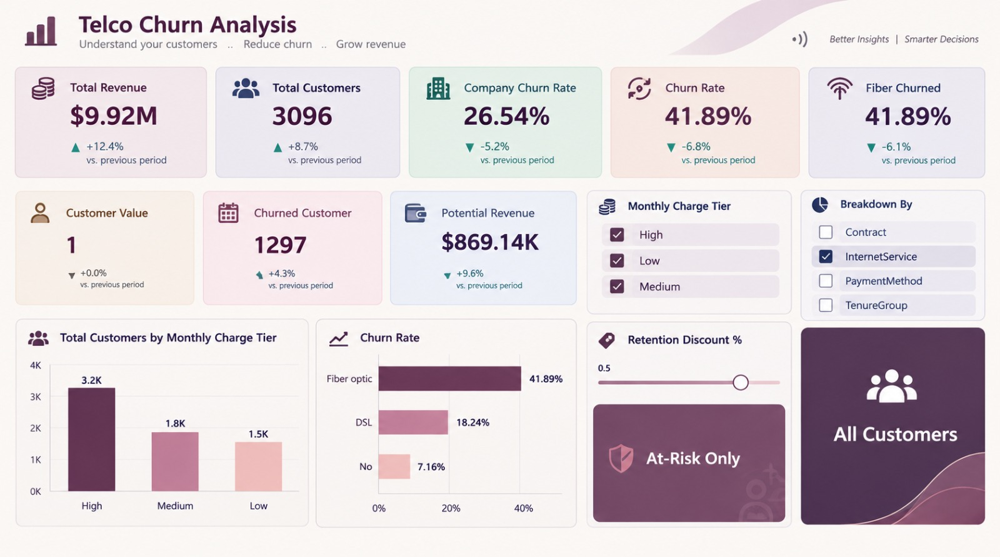

# 📊 Telco Churn Analysis
### Understand your customers .. Reduce churn .. Grow revenue
> Better Insights | Smarter Decisions

## 📌 Overview
This Power BI project analyzes customer churn for a Telco company to identify at-risk customers and reduce revenue loss. The dashboard provides a 360° view of churn behavior by Internet service, contract type, and monthly charges.

**Live Project:** Telco Churn Analysis Dashboard

## 🎯 Business Problem
Telco companies lose revenue due to high customer churn. The goal is to:
- Understand why customers churn
- Identify high-risk segments
- Provide actionable retention strategies

## 📈 Key KPIs (From Dashboard)

| Metric | Value | Insight |
| :--- | :--- | :--- |
| **Total Revenue** | **$9.92M** | +12.4% vs previous period |
| **Total Customers** | **3,096** | +8.7% vs previous period |
| **Company Churn Rate** | **26.54%** | -5.2% improvement |
| **Churned Customers** | **1,297** | |
| **Potential Revenue at Risk** | **$869.14K** | Needs retention |
| **Fiber Churned** | **41.89%** | Highest risk segment |

## 🔍 Key Insights

1. **Fiber Optic is the #1 Churn Driver:** 41.89% churn rate vs DSL 18.24% vs No Internet 7.16%
2. **High Monthly Charge = High Churn:** 3.2K customers in High tier are most likely to churn
3. **Monthly Charge Tier Filter** shows High, Medium, Low segments behavior
4. **At-Risk Only** feature with Retention Discount % slider (0.5%) helps simulate retention offers

## 🖥️ Dashboard Preview

### Features:
- ✅ Dynamic Slicers: Monthly Charge Tier (High/Medium/Low)
- ✅ Breakdown By: Contract, InternetService, PaymentMethod, TenureGroup
- ✅ Churn Rate by Internet Type (Bar Chart)
- ✅ Total Customers by Monthly Charge Tier
- ✅ At-Risk Only feature with Retention Discount % slider
- ✅ Potential Revenue Simulation

## 🛠️ Tools & Technologies
- **Power BI Desktop** – Data Visualization & Dashboard
- **DAX** – 10+ Measures (Churn Rate, Potential Revenue, etc.)
- **Power Query** – ETL & Data Cleaning
- **Data Modeling** – Relationships & Hierarchies

## 📂 Files in Repo
- `Telco Churn Analysis.pbix` – Power BI file
- `Telco_customer_churn.csv` – Dataset
- `IMG-20261008-WA0024.jpg` – Dashboard screenshot

## 💡 Recommendations
Based on analysis:
1. Offer retention discount for Fiber customers (41.89% churn)
2. Focus on High monthly charge tier – 3.2K customers need loyalty program
3. Investigate Fiber service quality – technical issues may cause churn
4. Use $869.14K potential revenue as budget for retention campaign

## 👩‍💻 Author
**Nermeen Elsayed Farg**
- Agricultural Economist | Data Analyst
- Zagazig University – 92.6% Honors
- [LinkedIn](https://linkedin.com/in/nermeen-farg) | [GitHub](https://github.com/nermeenfarg)

---
⭐ If you found this useful, give it a star!
